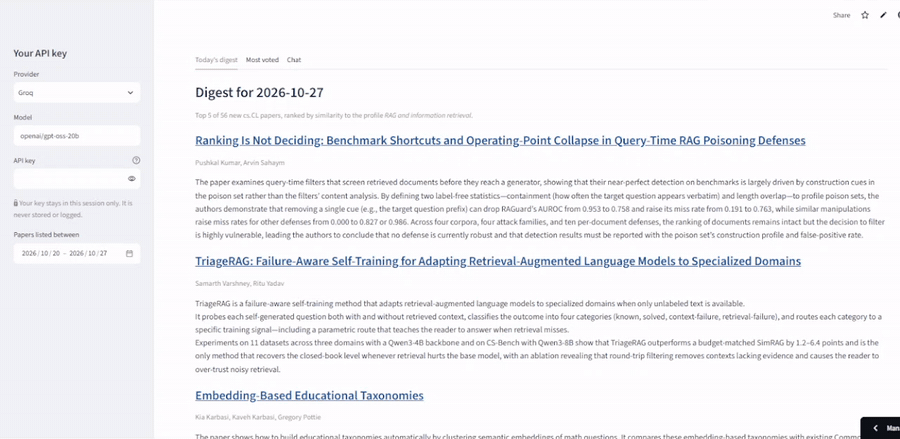
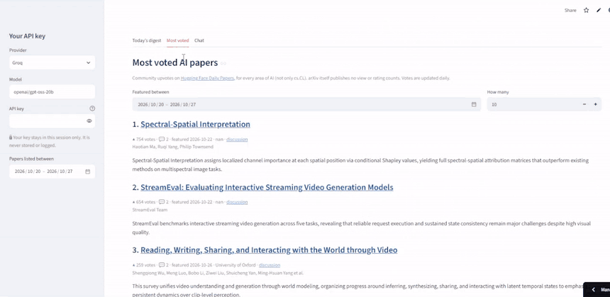
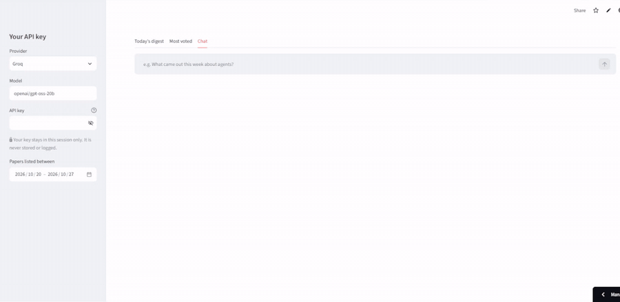
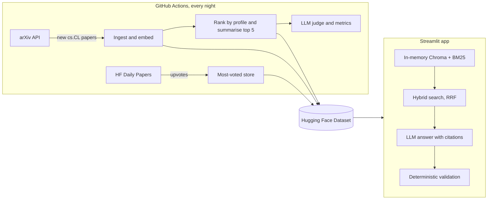

# RAG assistant for AI research papers

[](https://ai-research-papers-guipeliceri.streamlit.app/)
[](https://github.com/guipeliceri/RAG-assistant-for-AI-research-papers/actions/workflows/tests.yml)
[](https://github.com/guipeliceri/RAG-assistant-for-AI-research-papers/actions/workflows/daily.yml)
[](LICENSE)

A retrieval-augmented generation (RAG) assistant that keeps up with new AI papers on arXiv for you.
Every day it picks the papers that match an interest profile and summarises them, it shows the
papers the community voted for most, and it answers questions about the literature with a citation
on every claim, checked automatically.

**Live app:** [https://ai-research-papers-guipeliceri.streamlit.app](https://ai-research-papers-guipeliceri.streamlit.app/). It runs entirely on free tiers, and no key is needed
for the digest or the most-voted list.

## Demo

**Daily digest.** The top papers of the day for the interest profile, each with a short summary.



**Most voted.** Pick a period and how many papers to show.



**Chat.** A question in Portuguese, an answer with citations, and the retrieved papers it did not use.



## Why

Dozens of new language-model papers appear on arXiv every day. Nobody can read them all, and a
question like "what came out this week about mixture-of-experts?" ends up as manual digging through
listings. This project automates the reading list and makes the literature searchable, and it
measures how good it is at both jobs instead of assuming it.

## Features

| | |
| :--- | :--- |
| **Daily digest** | Every night a GitHub Actions job fetches the new `cs.CL` papers, ranks them against [`profile.md`](profile.md) (currently *advances in current frontier models*) and writes a short summary of the top 5. |
| **Most voted** | For any period you choose, the AI papers with the most upvotes on [Hugging Face Daily Papers](https://huggingface.co/papers). It is the same list for every user and covers all of AI. |
| **Chat with citations** | Ask in any language. Answers are grounded in the retrieved abstracts, every factual sentence cites an arXiv ID, and each answer is validated without an LLM before you see it. |
| **Bring your own key** | The chat uses your own Groq, OpenRouter or Gemini key. It stays in your browser session and is never stored or logged. |
| **Measured quality** | Digest precision@5 is scored by an LLM judge that is itself checked against hand-labelled papers, and chat faithfulness is checked on fixed questions. The results are published below and refreshed daily. |

## How it works



1. **Ingestion.** The arXiv API is queried for `cs.CL` papers created or revised in the last days.
   The key is the arXiv ID without its version, so a revision updates its row instead of adding a
   duplicate. Each paper keeps the date it was first announced, so a revision never shows up in a
   later digest again.
2. **Embeddings.** `BAAI/bge-small-en-v1.5` runs on CPU through ONNX Runtime (no PyTorch) over
   `title. abstract`. The vectors are L2-normalised and stored in a Parquet file.
3. **Storage.** A Hugging Face Dataset is the single source of truth. The workflow runners and the
   app keep nothing between runs: they pull the Parquet files, work on them, and push them back.
4. **Digest.** Papers announced on the latest day are ranked by cosine similarity to the profile.
   No LLM is involved in the ranking. The top 5 are summarised from their abstracts. If the LLM
   fails or runs out of quota, the digest is still published with titles and links.
5. **Retrieval.** The app loads the vectors into an in-memory Chroma collection and builds a BM25
   index next to it. A query runs on both, and the two rankings are fused with reciprocal rank
   fusion. The date range is applied before ranking. BM25 keeps names like `gpt-4o` or `llama-3.1`
   whole, which is where hybrid search beats pure vector search.
6. **Chat.** The question is first rewritten by the LLM into a short English search query, because
   the papers and the embedding model are in English. Only the retrieved abstracts go to the LLM,
   which must cite `[arxiv_id]` on every factual sentence and answers in the language of the
   question.
7. **Validation.** Before an answer is shown, plain code checks that every cited ID was actually
   retrieved and that every number in the answer appears in a source or in the question. A failed
   check is shown as a warning that names what failed. Only the cited papers are listed as
   sources.

## Evaluation

<!-- metrics:start -->
| Metric | Value | Based on |
| :--- | :--- | :--- |
| Digest precision@5 (mean, target ≥ 0.80) | n/a | 0 days |
| Judge vs human accuracy | n/a | 0 labelled papers |
| Judge vs human Cohen's κ | n/a |  |
| Chat answers failing validation | 0% | 2 fixed questions |
<!-- metrics:end -->

*The table is refreshed by the daily workflow.*

- **Digest relevance.** An LLM judge (`openai/gpt-oss-120b`, a different model from the summariser)
  labels each digest paper relevant or not to the profile with an explicit rubric
  ([`judge.py`](src/rag_papers/judge.py)). Precision@5 is averaged over days, with a target of
  0.80. Judgments are cached per profile, so a profile change starts the metric from scratch.
- **Can the judge be trusted?** It is calibrated against 30 papers labelled by hand in
  [`eval/golden.csv`](eval/golden.csv): 10 most similar to the profile, 10 from the middle and 10
  at random, shuffled. Accuracy, Cohen's κ and the disagreements in both directions are reported,
  because a judge that always says "relevant" could look good on accuracy alone.
- **Faithfulness.** 15 fixed questions go through the chat, and the share of answers that fail the
  deterministic checks is reported.

If precision@5 ends up below 0.80, that goes in a failure analysis (what changed in the profile,
the embedding or the filter, and the effect), not hidden.

## Tech stack

| Layer | Choice |
| :--- | :--- |
| Data sources | arXiv API, Hugging Face Daily Papers API |
| Embeddings | `BAAI/bge-small-en-v1.5` on ONNX Runtime |
| Retrieval | Chroma (in memory) + BM25 (`rank-bm25`), reciprocal rank fusion |
| LLMs | Groq (`openai/gpt-oss-20b` for summaries and chat, `openai/gpt-oss-120b` as judge); OpenRouter and Gemini as BYOK options |
| Storage | Parquet on a Hugging Face Dataset |
| Scheduling | GitHub Actions (daily digest, keep-awake, tests) |
| App | Streamlit on Streamlit Community Cloud |

## Run it locally

```bash
git clone https://github.com/guipeliceri/RAG-assistant-for-AI-research-papers.git
cd RAG-assistant-for-AI-research-papers
python -m venv .venv && source .venv/bin/activate
pip install -r requirements.txt
pytest

# Optional: read the public data from your Dataset and open the app
export HF_DATASET_REPO=your-hf-user/arxiv-cs-cl-papers
streamlit run app.py
```

Useful commands (run with `PYTHONPATH=src`):

| Command | What it does |
| :--- | :--- |
| `python -m rag_papers.ingest --days 30` | Fetch the last 30 days of `cs.CL` into `data/papers.parquet` |
| `python -m rag_papers.embed` | Embed papers that have no embedding yet |
| `python -m rag_papers.digest` | Build the digest for the latest listing day |
| `python -m rag_papers.popular --days 30` | Collect the most-voted papers |
| `python -m rag_papers.evaluate digests` | Score the digests with the judge |
| `python scripts/inspect_queries.py` | Compare vector, keyword and hybrid search on 10 test queries |

## Run your own copy

1. **Fork** this repository and create free accounts on Hugging Face and Groq.
2. In **Settings → Secrets and variables → Actions**, add:

   | Kind | Name | Value |
   | :--- | :--- | :--- |
   | Secret | `HF_TOKEN` | Hugging Face token with write access |
   | Secret | `GROQ_API_KEY` | Groq API key |
   | Variable | `HF_DATASET_REPO` | `your-hf-user/arxiv-cs-cl-papers` (created on the first run) |
   | Variable | `STREAMLIT_APP_URL` | Your app URL, for the keep-awake job |

3. Edit [`profile.md`](profile.md) to describe what you want to read about.
4. Run the **daily digest** workflow once from the Actions tab. The first run backfills 30 days of
   papers and 180 days of votes.
5. On [share.streamlit.io](https://share.streamlit.io), create an app from your fork (branch
   `main`, file `app.py`, Python 3.11) and add the secret
   `HF_DATASET_REPO = "your-hf-user/arxiv-cs-cl-papers"`.
6. To calibrate the judge, run the **golden template** workflow, label the 30 rows of
   `eval/golden.csv` with 1 (relevant) or 0, and commit the file.

From then on everything runs by itself. The digest runs at 01:30 UTC, after arXiv's evening
announcement. A failed run opens an issue in the repository. Free Streamlit apps sleep after some
hours without visits, so the **keep app awake** workflow visits the app every 4 hours and wakes it
if needed.

## Repository layout

| Path | Contents |
| :--- | :--- |
| `src/rag_papers/` | Ingestion, embeddings, retrieval, digest, chat, evaluation |
| `app.py` | Streamlit app |
| `tests/` | Unit tests, with no network access needed |
| `digests/` | One JSON file per day |
| `eval/` | Golden set, judge cache, metrics |
| `scripts/` | Retrieval inspection, keep-awake |
| `docs/decisions.md` | Design decisions and the corrections made to the original plan |
| `.github/workflows/` | Daily digest, ingest, golden template, keep-awake, tests |

## Limitations

- Only `cs.CL` is ingested, and only abstracts are used, not full texts.
- Each chat question gets a single retrieval pass, so comparative questions ("which papers compare
  X with Y?") work only when both sides show up in the same top results.
- The most-voted list covers only what the community features on Hugging Face Daily Papers.
- Free-tier rate limits can leave summaries empty or slow the evaluation down.

## Roadmap

This repository is **Phase A**: a classic RAG pipeline, finished and evaluated. **Phase B**, an
agentic version where the model plans its own steps (search the base, search arXiv live, read the
full paper, compare papers, verify citations), will be built in a separate repository. It will be
measured against these results.

## License

[CC0 1.0](LICENSE): public domain.
