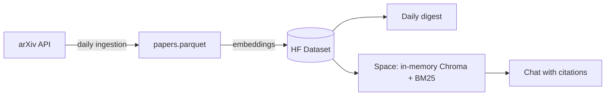

# RAG assistant for AI research papers

RAG assistant for AI research papers (arXiv cs.CL): automated daily digest with summaries and a chat that cites its sources. Hybrid retrieval (BM25 + embeddings), date filtering, LLM-as-judge evaluation, and BYOK.

**Status:** under construction (milestone 5 of 8: public deploy).

## The problem

Dozens of new AI papers land on arXiv every day. Nobody can read them all, and answering "what came out this week about X?" turns into manual digging.

## What it does

1. **Automatic daily digest.** A GitHub Actions job fetches the new `cs.CL` papers, picks the ones closest to an interest profile (embedding similarity, no LLM involved) and writes a short summary of each.
2. **Chat with citations.** Ask a question and every claim in the answer cites the arXiv ID it came from. You bring your own API key, which lives only in your session.
3. **Honest evaluation.** Digest quality is measured as precision@5 by an LLM judge that is calibrated against hand-labelled papers, and the judge-vs-human agreement is reported too.

## Architecture (draft)



## Repository layout

| Path | Contents |
| :--- | :--- |
| `src/rag_papers/` | Code: ingestion, retrieval, digest, chat |
| `tests/` | Automated tests |
| `digests/` | Daily digests (JSON) |
| `docs/` | Design decisions |
| `profile.md` | Interest profile used to rank the digest |

## Running locally

```bash
python -m venv .venv && source .venv/bin/activate
pip install -r requirements.txt
cp .env.example .env   # fill in your own tokens
pytest
```

## Ingestion

```bash
PYTHONPATH=src python -m rag_papers.ingest --days 30
```

Fetches every `cs.CL` paper created or revised in the last N days into `data/papers.parquet`.
It is idempotent: the key is the arXiv ID without version, a revision updates the existing
row (newest content, all versions kept in `versions`), and `listing_date` stays the day v1
was announced, so revisions never re-enter a digest. See [docs/decisions.md](docs/decisions.md)
for how the listing date is computed. On GitHub, the **ingest** workflow (Actions tab →
*Run workflow*) runs it against the real API and uploads the Parquet file.

## Retrieval

```bash
PYTHONPATH=src python -m rag_papers.embed            # embeds papers that have no embedding yet
PYTHONPATH=src python scripts/inspect_queries.py     # 10 test queries, vector vs keyword vs hybrid
```

Embeddings come from `BAAI/bge-small-en-v1.5` on CPU, L2-normalised, over `title. abstract`, and
are stored in the Parquet file. `rag_papers.retrieval.Index` loads them into an in-memory Chroma
collection, builds a BM25 index next to it, and `Index.search(query, start, end, k)` fuses both
rankings with reciprocal rank fusion. The date range is applied before ranking, on the listing date.
The BM25 tokenizer keeps names like `gpt-4o` or `llama-3.1` whole, which is where hybrid beats
pure vector search.

## Daily digest

The **daily digest** workflow runs every day at 01:30 UTC, after arXiv's evening announcement:

1. pull `papers.parquet` from the Hugging Face Dataset (the source of truth; the runner keeps nothing),
2. ingest (30-day backfill on the very first run, then the last 3 days),
3. embed the new papers,
4. rank the papers first listed on the latest listing day by similarity to [`profile.md`](profile.md)
   and summarise the top 5 from their abstracts only,
5. push the store and digests back to the Dataset and commit `digests/YYYY-MM-DD.json` here.

If the LLM call fails or hits its quota, the digest is still published with titles and links, and
`summary` is `null`. If the job itself fails, it opens an issue in this repository.

**Setup** (Settings → Secrets and variables → Actions):

| Kind | Name | Value |
| :--- | :--- | :--- |
| Secret | `HF_TOKEN` | Hugging Face token with write access |
| Secret | `GROQ_API_KEY` | Groq API key |
| Variable | `HF_DATASET_REPO` | `your-hf-user/arxiv-cs-cl-papers` (created on first run) |
| Variable | `HF_SPACE_REPO` | `your-hf-user/ai-papers-assistant` (created on first deploy) |

## Chat with citations (BYOK)

```bash
PYTHONPATH=src streamlit run app.py
```

Two tabs: **Today's digest** (no key needed) and **Chat**. The chat runs hybrid retrieval over the
chosen date range, sends only the retrieved abstracts to the LLM, and requires a `[arxiv_id]`
citation on every factual sentence. Each answer is then checked without any LLM:

- every cited ID must be one of the retrieved papers;
- every number in the answer must appear in a retrieved abstract (or in the question).

If a check fails, the answer is shown with a warning that says what failed, and the sources are
always listed under it. You pick the provider (Groq, OpenRouter or Gemini, all through their
OpenAI-compatible endpoints) and paste your own key. It lives in the Streamlit session only: it is
never written to disk, logged, or included in error messages.

Known limitation: comparative questions ("which papers compare X with Y?") get one retrieval pass,
so they only work when both sides show up in the same top results. That is what Phase B addresses.

## Deploy (Hugging Face Space)

The **deploy space** workflow pushes the app to a Docker Space every time `main` changes (or on
demand from the Actions tab). The image bakes in CPU torch and the embedding model, so a cold start
only has to download the Dataset and rebuild the in-memory index. The app re-checks the Dataset every
hour, so the new daily digest shows up without a redeploy. Space metadata lives in
[`space/README.md`](space/README.md).

## Roadmap

- **Phase A (MVP):** classic RAG with hybrid retrieval, digest and chat.
- **Phase B:** agentic version with a query router and citation verification.
