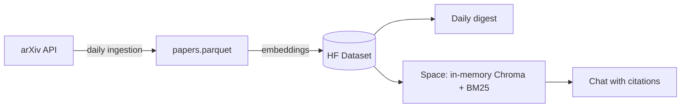

# RAG assistant for AI research papers

RAG assistant for AI research papers (arXiv cs.CL): automated daily digest with summaries and a chat that cites its sources. Hybrid retrieval (BM25 + embeddings), date filtering, LLM-as-judge evaluation, and BYOK.

**Status:** under construction (milestone 1 of 8).

## The problem

Dozens of new AI papers land on arXiv every day. Nobody can read them all, and answering "what came out this week about X?" turns into manual digging.

## What it does

1. **Automatic daily digest.** A GitHub Actions job fetches the new `cs.CL` papers, picks the ones closest to an interest profile (embedding similarity, no LLM involved) and writes a short summary of each.
2. **Chat with citations.** Ask a question and every claim in the answer cites the arXiv ID it came from. You bring your own API key, which lives only in your session.
3. **Honest evaluation.** Digest quality is measured as precision@5 by an LLM judge that is calibrated against hand-labelled papers, and the judge-vs-human agreement is reported too.

## Architecture (draft)



## Repository layout

| Path | Contents |
| :--- | :--- |
| `src/rag_papers/` | Code: ingestion, retrieval, digest, chat |
| `tests/` | Automated tests |
| `digests/` | Daily digests (JSON) |
| `docs/` | Design decisions |
| `profile.md` | Interest profile used to rank the digest |

## Running locally

```bash
python -m venv .venv && source .venv/bin/activate
pip install -r requirements.txt
cp .env.example .env   # fill in your own tokens
pytest
```

## Roadmap

- **Phase A (MVP):** classic RAG with hybrid retrieval, digest and chat.
- **Phase B:** agentic version with a query router and citation verification.
