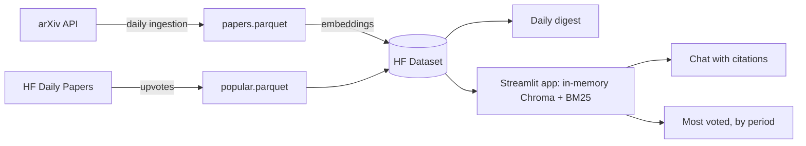

# RAG assistant for AI research papers

RAG assistant for AI research papers (arXiv cs.CL): automated daily digest with summaries and a chat that cites its sources. Hybrid retrieval (BM25 + embeddings), date filtering, LLM-as-judge evaluation, and BYOK.

**Status:** under construction (milestone 6 of 8: evaluation).

## The problem

Dozens of new AI papers land on arXiv every day. Nobody can read them all, and answering "what came out this week about X?" turns into manual digging.

## What it does

1. **Automatic daily digest.** A GitHub Actions job fetches the new `cs.CL` papers, picks the ones closest to an interest profile (embedding similarity, no LLM involved) and writes a short summary of each.
2. **Most voted papers.** For any period you pick, the AI papers with the most community upvotes on Hugging Face Daily Papers (every area of AI, for every user, no profile involved).
3. **Chat with citations.** Ask a question and every claim in the answer cites the arXiv ID it came from. You bring your own API key, which lives only in your session.
4. **Honest evaluation.** Digest quality is measured as precision@5 by an LLM judge that is calibrated against hand-labelled papers, and the judge-vs-human agreement is reported too.

## Architecture (draft)



## Repository layout

| Path | Contents |
| :--- | :--- |
| `src/rag_papers/` | Code: ingestion, retrieval, digest, chat |
| `tests/` | Automated tests |
| `digests/` | Daily digests (JSON) |
| `docs/` | Design decisions |
| `profile.md` | Interest profile used to rank the digest |

## Running locally

```bash
python -m venv .venv && source .venv/bin/activate
pip install -r requirements.txt
cp .env.example .env   # fill in your own tokens
pytest
```

## Ingestion

```bash
PYTHONPATH=src python -m rag_papers.ingest --days 30
```

Fetches every `cs.CL` paper created or revised in the last N days into `data/papers.parquet`.
It is idempotent: the key is the arXiv ID without version, a revision updates the existing
row (newest content, all versions kept in `versions`), and `listing_date` stays the day v1
was announced, so revisions never re-enter a digest. See [docs/decisions.md](docs/decisions.md)
for how the listing date is computed. On GitHub, the **ingest** workflow (Actions tab →
*Run workflow*) runs it against the real API and uploads the Parquet file.

## Retrieval

```bash
PYTHONPATH=src python -m rag_papers.embed            # embeds papers that have no embedding yet
PYTHONPATH=src python scripts/inspect_queries.py     # 10 test queries, vector vs keyword vs hybrid
```

Embeddings come from `BAAI/bge-small-en-v1.5` on CPU, L2-normalised, over `title. abstract`, and
are stored in the Parquet file. `rag_papers.retrieval.Index` loads them into an in-memory Chroma
collection, builds a BM25 index next to it, and `Index.search(query, start, end, k)` fuses both
rankings with reciprocal rank fusion. The date range is applied before ranking, on the listing date.
The BM25 tokenizer keeps names like `gpt-4o` or `llama-3.1` whole, which is where hybrid beats
pure vector search.

## Daily digest

The **daily digest** workflow runs every day at 01:30 UTC, after arXiv's evening announcement:

1. pull `papers.parquet` from the Hugging Face Dataset (the source of truth; the runner keeps nothing),
2. ingest (30-day backfill on the very first run, then the last 3 days),
3. embed the new papers,
4. rank the papers first listed on the latest listing day by similarity to [`profile.md`](profile.md)
   and summarise the top 5 from their abstracts only,
5. push the store and digests back to the Dataset and commit `digests/YYYY-MM-DD.json` here.

If the LLM call fails or hits its quota, the digest is still published with titles and links, and
`summary` is `null`. If the job itself fails, it opens an issue in this repository.

**Setup** (Settings → Secrets and variables → Actions):

| Kind | Name | Value |
| :--- | :--- | :--- |
| Secret | `HF_TOKEN` | Hugging Face token with write access |
| Secret | `GROQ_API_KEY` | Groq API key |
| Variable | `HF_DATASET_REPO` | `your-hf-user/arxiv-cs-cl-papers` (created on first run) |

## Most voted papers

arXiv publishes no view or rating counts, so popularity comes from
[Hugging Face Daily Papers](https://huggingface.co/papers), where the community submits and upvotes
a few dozen AI papers a day. The daily workflow re-fetches the last 30 days on every run (votes keep
growing for days; the first run backfills 180 days) into `popular.parquet` on the Dataset. In the
app's **Most voted** tab anyone can pick a period and how many papers to show; papers are ranked by
upvotes, ties broken by comments. This list covers all of AI, is the same for every user, and does
not use the interest profile. Coverage is limited to what the community features on Daily Papers.

## Chat with citations (BYOK)

```bash
PYTHONPATH=src streamlit run app.py
```

Three tabs: **Today's digest** and **Most voted** (no key needed) and **Chat**. The papers and the
embedding model are English, so the chat first asks the LLM to turn the question (in any language)
into a short English search query, then runs hybrid retrieval over the chosen date range, sends only the retrieved abstracts to the LLM, and requires a `[arxiv_id]`
citation on every factual sentence. Each answer is then checked without any LLM:

- every cited ID must be one of the retrieved papers;
- every number in the answer must appear in a retrieved abstract (or in the question).

The answer comes back in the language of the question. Only the papers it cites are listed as
sources; the other retrieved papers are folded away under "Also retrieved but not used". If a check
fails, the answer is shown with a warning that says what failed, and the sources are
always listed under it. You pick the provider (Groq, OpenRouter or Gemini, all through their
OpenAI-compatible endpoints) and paste your own key. It lives in the Streamlit session only: it is
never written to disk, logged, or included in error messages.

Known limitation: comparative questions ("which papers compare X with Y?") get one retrieval pass,
so they only work when both sides show up in the same top results. That is what Phase B addresses.

## Deploy (Streamlit Community Cloud)

The app runs for free on [Streamlit Community Cloud](https://share.streamlit.io). Hugging Face
now requires a PRO plan for Docker Spaces, so the Space deploy was dropped (see
[decision 4](docs/decisions.md)). One-time setup:

1. Sign in at share.streamlit.io with the GitHub account that owns this repo.
2. **Create app** → this repo, branch `main`, main file `app.py`. Under **Advanced settings**, pick
   Python 3.11 and add the secret `HF_DATASET_REPO = "your-hf-user/arxiv-cs-cl-papers"`.
3. Deploy. Every push to `main` redeploys automatically.

Embeddings run through ONNX Runtime (no torch), so the app fits in the free tier's memory. On a cold
start it downloads the model (~130 MB) and the Dataset, then rebuilds the in-memory index. The app
re-checks the Dataset every hour, so the new daily digest shows up without a redeploy. Free apps
sleep after some hours without visits, so the **keep app awake** workflow opens the app in a
headless browser every 4 hours and clicks the wake-up button if it is asleep. Set the repository
variable `STREAMLIT_APP_URL` if the app URL changes.

## Evaluation

<!-- metrics:start -->
| Metric | Value | Based on |
| :--- | :--- | :--- |
| Digest precision@5 (mean, target ≥ 0.80) | 0.60 | 2 days |
| Judge vs human accuracy | n/a | 0 labelled papers |
| Judge vs human Cohen's κ | n/a |  |
| Chat answers failing validation | 0% | 2 fixed questions |
<!-- metrics:end -->

*The table is refreshed by the daily workflow.*

- **Digest relevance.** An LLM judge (`openai/gpt-oss-120b`, a different model from the
  summariser) labels each digest paper relevant or not to the profile, using an explicit rubric
  ([`judge.py`](src/rag_papers/judge.py)), and precision@5 is averaged over days.
- **Is the judge trustworthy?** It is calibrated against 30 papers labelled by hand in
  [`eval/golden.csv`](eval/golden.csv): we report accuracy, Cohen's κ, and the disagreements in
  both directions, because a judge that always agrees could hide a shared bias. The 30 papers are
  sampled by the **golden template** workflow: 10 most similar to the profile, 10 from the middle,
  10 random, shuffled.
- **Faithfulness.** 15 fixed questions go through the chat; we report the share of answers that
  fail the deterministic checks (unretrieved citation, number not in the sources, no citations).

If precision@5 lands below 0.80, that is documented as a failure analysis (what changed in the
profile, the embedding or the filter, and the effect), not hidden.

## Roadmap

- **Phase A (MVP):** classic RAG with hybrid retrieval, digest and chat.
- **Phase B:** agentic version with a query router and citation verification.
